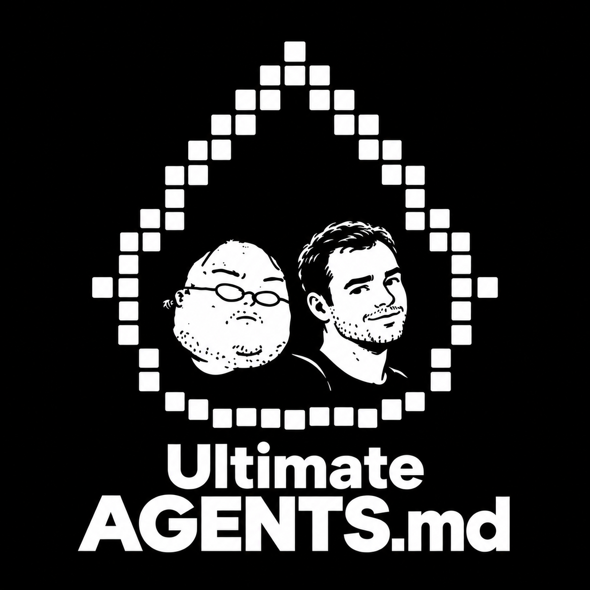

# Ultimate AGENTS.md

*A small rules file for agents with very big plans.*

One file to help coding agents think before editing, make small but complete changes, and explain the result clearly.

Ultimate AGENTS.md brings together ideas from three popular skills for coding agents. Their repositories have **more than 500,000 GitHub stars combined**.

**[Read the guidelines](./ultimate-agents.md)**

## Three skills, one file

| Source skill | What we use | Repository stars |
| --- | --- | --- |
| [Karpathy Guidelines](https://github.com/multica-ai/andrej-karpathy-skills/blob/main/skills/karpathy-guidelines/SKILL.md) | Clear assumptions, small changes, simple solutions, and results you can check. | [~222.8k](https://github.com/multica-ai/andrej-karpathy-skills) |
| [Ponytail](https://github.com/DietrichGebert/ponytail/blob/main/skills/ponytail/SKILL.md) | Complete solutions with less code, reuse of existing code, and tests. | [~174.6k](https://github.com/DietrichGebert/ponytail) |
| [Caveman](https://github.com/JuliusBrussee/caveman/blob/main/skills/caveman/SKILL.md) | Short answers that keep the important technical details. | [~114.5k](https://github.com/JuliusBrussee/caveman) |

## The main rules

- **Read first.** Understand the code and the parts that use it. Ask questions when the answer could change the task or its risks.
- **Complete the task.** Update all affected parts. A fixed function but three new bugs still need work.
- **Reuse what exists.** Start with project code, then standard language or platform features, then installed packages.
- **Stay focused.** Change what the task needs. The other files can wait for their own task.
- **Keep the protections.** Preserve input checks, security, data safety, accessibility, and project rules.
- **Check the result.** Run the right tests. Report failures and tests you could not run. Feeling confident does not count as a test.
- **Write clearly.** Start with the result and use the user's language. Keep commands, names, numbers, and errors exact.

## Use it in your project

1. Open [ultimate-agents.md](./ultimate-agents.md).
2. If your agent supports [AGENTS.md](https://agents.md/), copy the content into a file named `AGENTS.md` in your project's main folder. If that file already exists, combine the rules with your current instructions.
3. Add your project's setup commands, test commands, and coding rules.

If your agent uses a different instruction file, add the rules there. There are no packages, hooks, or extra skills to install.

## The Choices

- **Prefer less code.** For the requested task, choose the shorter correct solution. Keep all required protections. Explanations must still be clear.
- **Ask when it matters.** For small decisions that are easy to undo, state the assumption and continue. Ask before making a choice that changes the task, affects data, or is expensive to undo. Get approval for actions that cannot be undone, unless already approved.
- **No extra approval step for dependencies.** Adding a package does not need separate approval unless the user, project, or tool requires it.
- **One set of rules.** No commands to turn it on, no levels to choose, and no special way of speaking. Use normal language in files and documentation.

Specific project rules come before these general guidelines. Always respect the user's requirements and the tool's required rules.
